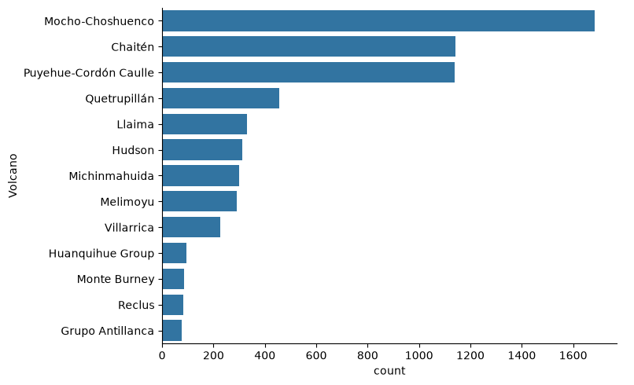
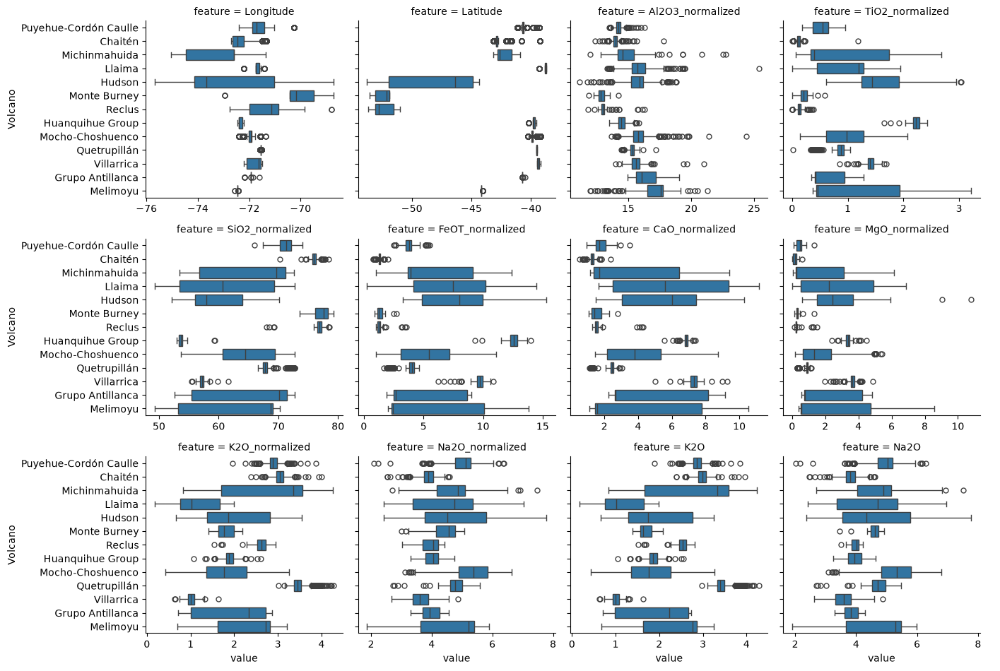
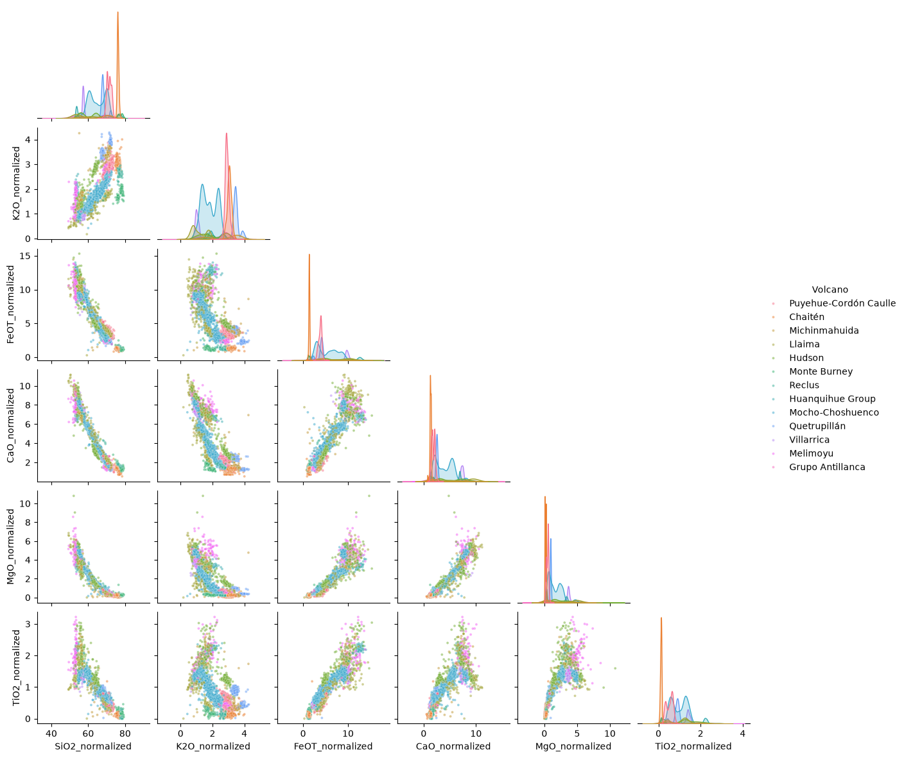
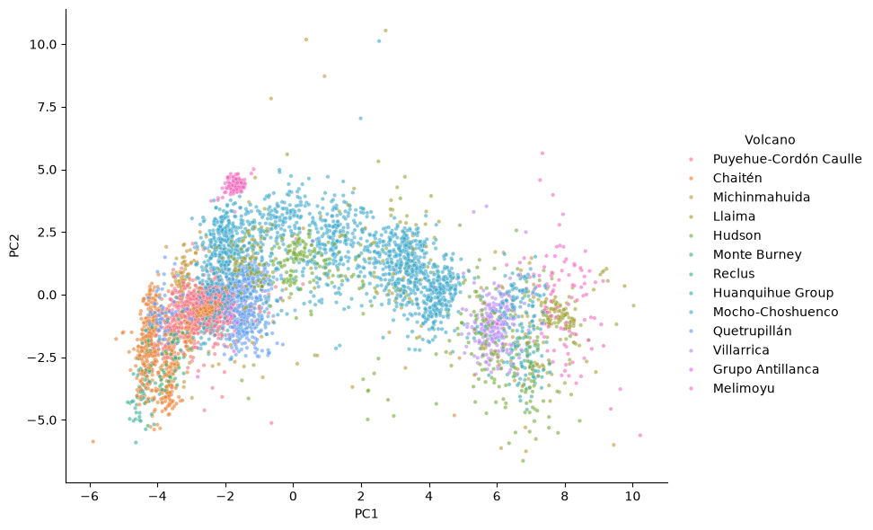

# Exploratory data analysis — Southern Andes tephra geochemistry

Task in view: tell which volcano an ash (tephra) sample came from, from
its geochemical measurements and metadata. The data ships as a training
table (`train.csv`) and a test table (`test.csv`); both are profiled
separately and never concatenated.

## Dataset at a glance

<iframe src="data_analysis_train.html" width="100%" height="640"></iframe>

<iframe src="data_analysis_test.html" width="100%" height="640"></iframe>

## Modelling implications

**Shape and duplicates.** Train has 6,220 rows and 95 columns, test has 839
rows with the same schema. Neither table has an exact duplicate row (0 and 0).

**Target (`Volcano`, 13 classes, no missing value).** The classes are
imbalanced: Mocho-Choshuenco has 1,685 rows and Chaitén 1,143, while Reclus
has 81 and Grupo Antillanca 77. Accuracy would be dominated by the three large
volcanoes, so a macro-averaged metric (or per-class recall) and stratified
handling are candidates for the comparison metric.

**Geochemistry separates volcanoes, but not cleanly.** Among the twelve most
complete numeric columns, `Latitude` and `Longitude` have no missing value and
sit in a narrow band per volcano. Major oxides such as `SiO2_normalized` and
`K2O_normalized` separate some volcanoes (Chaitén and Monte Burney are
silica-rich, Villarrica and Huanquihue Group much less so) and overlap heavily
for others (Hudson, Llaima, Melimoyu, Michinmahuida all span wide ranges).

**Missingness is structured and informative.** Major oxides (`SiO2`, `Al2O3`,
`Total`, …) are missing in about 21% of train rows, their `_normalized` copies
in about 18%, and trace elements (`Zr`, `Ba`, `La`, …) in about 78% to 79%.
The null rate depends on the class: for example `Zr` is missing in 99% of
Mocho-Choshuenco rows but in 3% of Grupo Antillanca rows, and `Magnitude` is
missing in 100% of Hudson rows but 0% of Quetrupillán rows. A learner that
handles missing values natively, or explicit missing indicators, are
candidates. Imputation choices belong in the pipeline. Whether that missingness
reflects the lab or the volcano is an open question.

**Leakage candidates (flags only).** In train, `Event` (30 values),
`SampleID` (455 values) and `SampleObservationID` (6,215 values) each map to
exactly one volcano for 100% of rows, so they identify the class and would not
exist for a genuinely new sample. `SectionID` (67%), `DOI` and `Authors`
(both 61%) are single-volcano for most rows and track the source publication
rather than the chemistry. `Latitude` and `Longitude` are also near-constant
per volcano, so they are a close proxy for the label.

**Split structure.** `SampleID` groups about 14 observations each (455 samples
for 6,220 rows). In test, none of its 118 `SampleID` values appears in train,
while all 30 `Event` values and all 13 volcanoes are shared. So the shipped
test table is split by sample, not by row. A random row split inside train
would put observations of one sample on both sides and overstate performance.
A group split on `SampleID` is a candidate for the training-side comparison.

**Joint structure of the oxides.** On the 5,095 train rows with all six
normalized oxides present, the pairwise views separate Chaitén and Monte
Burney (high SiO2, low FeOT) from Villarrica, Huanquihue Group and
Quetrupillán (distinct K2O or TiO2 bands), while Hudson, Llaima, Melimoyu and
Michinmahuida overlap heavily in every pair.

**Low-dimensional structure.** On the 20 major-oxide columns (at most 25%
missing, coordinates excluded), the first two principal components explain 58%
and 15% of the variance. Chaitén, Monte Burney and Reclus pile up at the low
PC1 end, Villarrica and Hudson at the high end, and Mocho-Choshuenco spreads
across the middle, so the volcanoes are separable but overlap along a
continuum. A flexible nonlinear learner is a candidate over a linear one.

**Univariate signal.** Of 79 tests (61 Kruskal-Wallis on numeric columns, 18
chi-square on text columns), 76 give p < 0.05, so p-values barely discriminate
at n = 6,220. By statistic, `Latitude` (5,435), `K2O_normalized` (3,859),
`K2O` (3,685), `SiO2_normalized` (3,523) and `Al2O3_normalized` (3,339) lead
among numeric columns. Among text columns, `Event` (chi-square 74,640) and
`MeasurementRun` (40,780) rank first,
`DOI` and `Authors` (39,182 each) follow. This confirms that the metadata
columns carry the label by provenance. `LOI` (p = 0.16) and `TypeOfRegister`
(p = 0.71) show no class signal.

**Coordinates.** No coordinate is out of range (0 rows). Per-volcano spans are
small for most volcanoes (latitude span under 1 degree for 6 of 13, for
example 0.08 for Quetrupillán and 0.12 for Melimoyu) and large for Hudson
(9.4 degrees in latitude, 7.0 in longitude). Coordinates therefore nearly
reveal the volcano by themselves.

**Train versus test keys.** None of the 118 test `SampleID` values appears
among the 455 train ones (0 shared), confirming the sample-level split noted
above.

**Publication as a proxy for the label.** Grouping train by `Authors`,
18 of 25 publications cover a single volcano, which accounts for 3,791 of
6,220 rows (61%). The largest, Rawson et al., 2015 (1,359 rows), covers only
Mocho-Choshuenco, and Alloway et al., 2017a (1,001 rows) only Chaitén. Only
Fontijn et al., 2016 (1,771 rows) spreads across 6 volcanoes. A model could
learn the lab and publication signature (see the missing-value patterns above)
instead of the chemistry, so a test on publications unseen in training is
worth considering.

**Free-text columns.** `Comments` (91% missing, 18 distinct values),
`Location` (70% missing, 58 values), `FlagDescription` (45% missing, 38
values, median length 163 characters) and `DepositColor` (87% missing, 20
values) have no empty strings, and few distinct values relative to their
length, so they behave like categorical codes and not like free text. They are
too sparse to be a first-choice input.

**Oxide totals and instruments.** The oxide sum `Total` (4,938 train rows)
averages 99.1 with a standard deviation of 1.5 and a range of 95.0 to 103.0.
By volcano the mean ranges from 96.6 (Reclus) and 97.0 (Monte Burney) to 101.1
(Melimoyu), so analytical quality differs across volcanoes and totals above
100 occur. The instrument is nearly confounded with the data layout: the 4,790
EMP rows carry major oxides (97% with `SiO2`) but almost no trace elements
(0.7% with `Zr`), while the 1,092 LA-ICP-MS rows have trace elements (100% with
`Zr`) and almost no major oxides (0.1% with `SiO2`). That explains the 78% trace
element missingness. Techniques also pick volcanoes: EMP covers all 13, but
LA-ICP-MS covers 7, and several multi-technique labels cover a single volcano
(for example 48 Llaima rows measured by EMP, SIMS and LA-ICP-MS). A model can therefore read the instrument as a class hint,
and the trace-element and major-oxide subsets are really two different
populations.

**Repeated analyses are near copies.** Within one `SampleID`, only 3% (SiO2),
5% (K2O) and 4% to 8% (FeOT, CaO, MgO, TiO2) of the variance of the normalized
oxides is left, while the volcano explains 47% to 73% of it. For trace elements
the within-sample share is larger (Zr 14%, Nb 23%, Ba 30%). Rows from one
sample are almost interchangeable, so a random row split would put near
duplicates in both folds and overstate accuracy. Group folds by `SampleID` are
a candidate.

**Effective sample size per class.** Behind the 13 classes there are only 5
samples for Huanquihue Group, 6 for Monte Burney, 10 for Villarrica, 11 for
Grupo Antillanca and 12 for Melimoyu, each with a single event, against 90 for
Mocho-Choshuenco and 164 for Llaima (about 2 rows per sample, while the other
volcanoes average 6 to 30). The test table has 34 Michinmahuida samples (21 in
train) and 10 for Reclus (14 in train), so the class mix in test differs from
train.

**Log-ratio versus raw scale.** On the 5,086 rows where eight normalized oxides
are all positive, the share of variance explained by the volcano rises with the
centered log-ratio for `TiO2` (0.59 to 0.76), `MgO` (0.47 to 0.60), `SiO2` (0.65
to 0.72), `Al2O3` (0.60 to 0.67) and `Na2O` (0.42 to 0.50), and falls for `K2O`
(0.73 to 0.69) and `CaO` (0.52 to 0.48). For `La_Yb`, the log lifts it from 0.68
to 0.86, and `Zr_Nb` is high on either scale (0.93 and 0.92). Log-ratio
features are a candidate, but not a uniform gain.

## Open questions

- Should `Event`, `SampleID`, `SampleObservationID`, `Location`, `Authors`,
  `DOI`, `Latitude` and `Longitude` be excluded? They identify the volcano
  without measuring the chemistry. Latitude and longitude depend on the real
  deployment: if the future sample has a known location the task is
  different.
- What is the deployment target: a new sample from a known volcano, as the
  test table suggests?
- Is the missing-value pattern a lab/publication artifact, and would it
  carry over to new samples?
- `Flag` and `FlagDescription` are filled for about 55% of rows. Do they mark
  rows that should be treated differently?
- Which metric should compare candidates, given the 13 imbalanced classes and
  only 5 to 12 independent samples for five of them?
- Should the major-oxide rows (EMP) and the trace-element rows (LA-ICP-MS) be
  modelled as one table or as two populations?
- Should `Total` outside a plausible range (for example above 100) mark rows
  to treat separately? Only the data owner can say.
